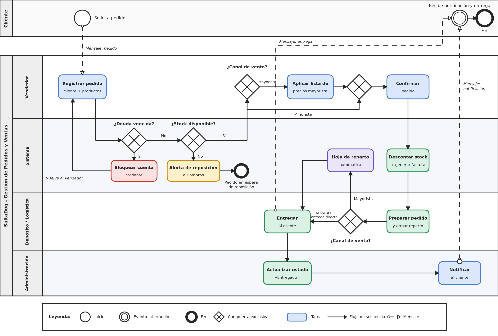

# Sistema de Gestión de Pedidos y Ventas - SaltaDog

Trabajo Práctico Integrador - Organización Empresarial  
Tecnicatura Universitaria en Programación - UTN

---

## 📋 Descripción del Sistema
SaltaDog — Sistema de Gestión de Pedidos y Ventas

SaltaDog es una distribuidora de artículos e insumos para el cuidado animal con sede en Salta, Argentina, que opera tanto en canal mayorista (veterinarias, petshops y criaderos) como en canal minorista de mostrador. Hasta el momento, la gestión de pedidos, el control de stock y la facturación se realizan de forma manual y fragmentada, lo que genera errores en el inventario, ventas sin stock real, demoras en la logística de entrega y falta de visibilidad comercial para la dirección. Este software resuelve ese problema unificando en una única plataforma digital todos los procesos críticos del negocio: el registro de pedidos por canal, la actualización automática del stock en tiempo real, la generación automática de comprobantes de venta, la planificación de repartos para clientes mayoristas y el historial de condiciones particulares por cliente. Además, incorpora restricciones automáticas de crédito para clientes con deuda vencida y alertas de reposición cuando el stock de un producto baja del mínimo definido.
El objetivo principal del sistema es eliminar la doble carga de datos entre ventas, inventario y facturación, reduciendo errores operativos y acelerando el circuito venta - entrega - cobro. A mediano plazo, la generación de reportes por canal, por cliente y por categoría de producto permitirá a la dirección de SaltaDog tomar decisiones comerciales y de compras basadas en datos reales, en lugar de intuición o registros dispersos.

---

## 👥 Integrantes del Grupo
Nombre y Apellido: Gastón Alejandro Pedraza
Comisión: Comisión 7
Legajo / Email: 810266 / alejo00292@gmail.com

---

## 🔗 Enlaces del Proyecto
Tablero Ágil (GitHub Projects / Jira): https://github.com/users/magnus92p/projects/2
Repositorio Público: https://github.com/magnus92p/tp-organizacion-empresarial-Pedraza-Gaston

## 🔄 Modelado del Proceso (BPMN)

El diagrama separa dos pools: el **Cliente** (actor externo) y **SaltaDog**, con cuatro carriles internos: Vendedor, Sistema, Depósito / Logística y Administración. El flujo estándar va desde la solicitud del pedido hasta la notificación y entrega al cliente. Las compuertas contemplan las excepciones del proceso: cliente con deuda vencida (se bloquea la cuenta corriente), falta de stock (alerta de reposición a Compras) y el canal de venta mayorista o minorista, que cambia la lista de precios y el tipo de entrega.

## 📌 Historias de Usuario

(Pendiente: pegar las 3 historias en formato "Como [usuario], quiero [funcionalidad], para [beneficio]", cada una con el enlace a su issue y su estado en el tablero: Por Hacer / En Progreso / Listo.)

## 📊 Indicadores de Control y Estándares de Desempeño

| Indicador | Estándar (meta) |
|---|---|
| Exactitud del inventario (diferencia entre stock del sistema y stock físico) | ≤ 2 % |
| Ventas confirmadas sin stock disponible | 0 |
| Cuentas con deuda vencida bloqueadas automáticamente | 100 % |
| Alertas de reposición generadas cuando el stock baja del mínimo | 100 % |
| Tiempo desde la confirmación hasta la entrega, canal mayorista | ≤ 48 h |
| Pedidos cargados una sola vez, sin doble carga entre ventas, stock y facturación | 100 % |

## 🤖 Declaración de Uso de IA

* **Uso efectuado:** Se utilizaron asistentes de Inteligencia Artificial para revisión de estilo del README, ayuda en comandos Git.
* **Prompts utilizados:** 
  1. ¿Cómo realizar un flujo de trabajo con ramas en Git Bash y Pull Request en GitHub?
  2. Revisión del formato del README para alinearlo a la consigna de la UTN.
 
## **Correcciones humanas efectuadas:**
  1. Revisé el diagrama BPMN contra la consigna con ayuda de IA, que marcó cuatro puntos (mensajes punteados, tarea automática en el carril Sistema, compuertas de deuda y stock en el Sistema, y mensaje de entrega al cliente). Evalué cada punto contra la lógica del proceso de SaltaDog y decidí aplicarlos.
  2. Reordené el repositorio: moví el diagrama a `docs/bpmn/` y eliminé la copia duplicada de la raíz.
**Responsabilidad:** revisé todo el contenido de este repositorio y asumo la responsabilidad por lo escrito.
